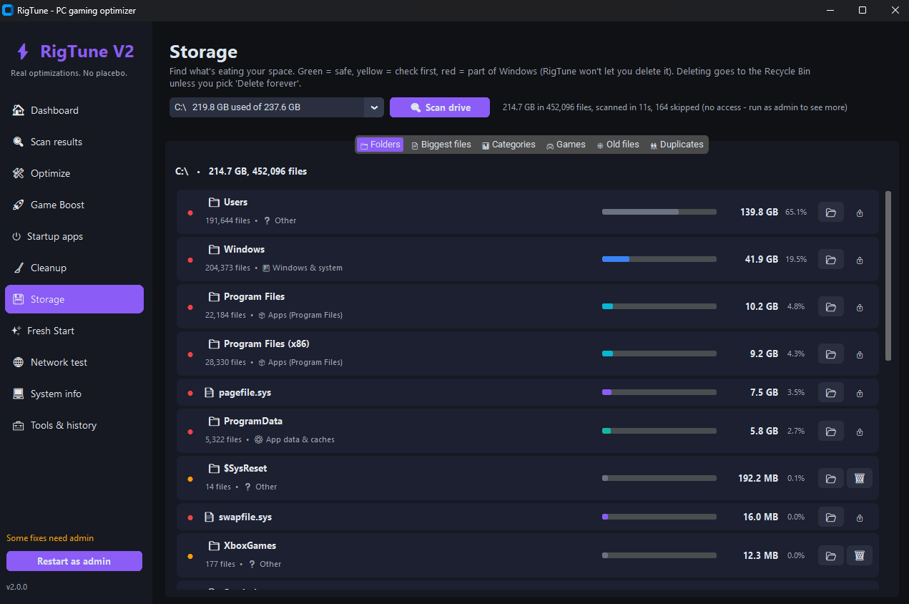
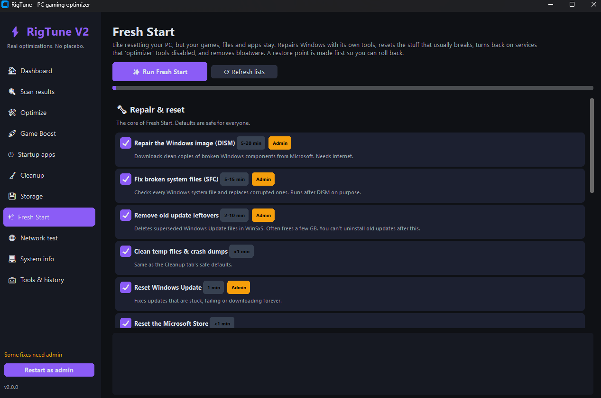
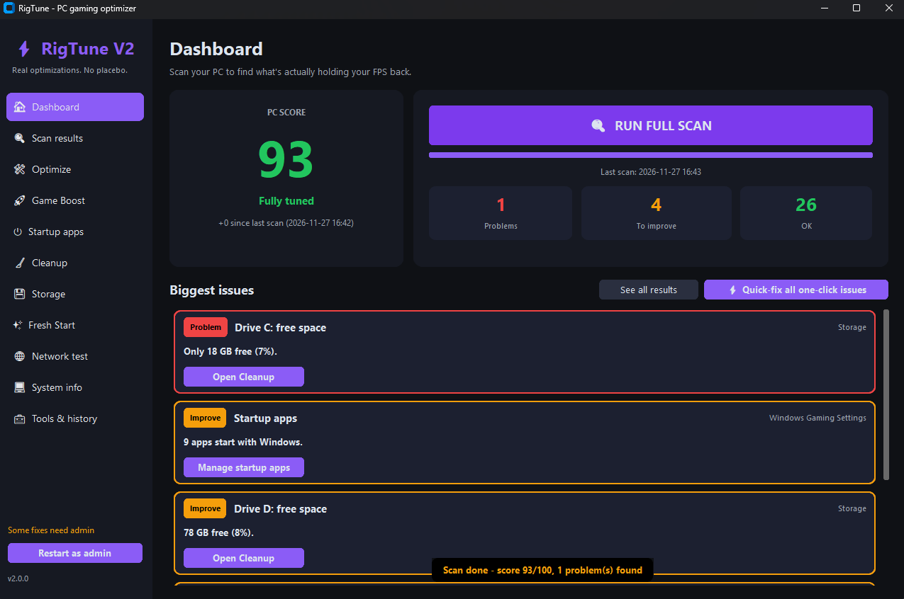

# ⚡ RigTune V2: real PC gaming optimizer

RigTune scans your PC, gives it a score out of 100, and shows you what's actually costing you FPS.
Most fixes take one click, and every change can be undone.

| Fresh Start | Dashboard |
|---|---|
|  |  |

## What's new in V2
- 💾 **Storage tab**: see exactly what's taking your space and delete it safely
- ✨ **Fresh Start tab**: repair and refresh Windows without resetting your PC

## How to run it
1. Install **Python 3.11+** from https://www.python.org/downloads/ and tick **"Add python.exe to PATH"**.
2. Double-click **`run.bat`**.
3. In the sidebar, click **"Restart as admin"** so every fix is available.

## Make it a real .exe
Double-click **`build_exe.bat`**. You'll get `dist\RigTune.exe`, a single file you can send to friends.
It asks for admin automatically when it opens.

## Features
**Scan + PC Score (out of 100)**
- Monitors: refresh rate (finds the "144Hz monitor running at 60Hz" mistake and fixes it in one click), native resolution, and **monitor plugged into the motherboard and not the GPU**
- Mouse: acceleration, Windows pointer speed, Sticky Keys popup
- RAM: **XMP/EXPO detection** with BIOS steps for your specific board (ASUS / MSI / Gigabyte / ASRock / Biostar / Dell / HP / Lenovo), plus links and a **"restart straight into BIOS"** button. Also checks dual channel (wrong slots), RAM amount and RAM usage
- GPU: driver age with download link, HAGS, windowed game optimizations, **PCIe lane check** (GPU in the wrong slot, NVIDIA cards), temperature
- Storage: free space, Windows on HDD, **games installed on an HDD** (Steam / Epic / Xbox / EA / Ubisoft / Riot / Battle.net), TRIM
- Windows: Game Mode, Xbox Game Bar background recording, Memory Integrity (explained, never changed for you), pending restart, startup app count, background apps
- Power: power plan (knows that the 7950X3D/7900X3D/9950X3D/9900X3D need Balanced), BIOS age, CPU load at idle
- Network: Wi-Fi vs Ethernet, Ethernet link speed

**Quick-fix all**: fixes every one-click issue in one go.

**Optimize**: 14 reversible tweaks, each with its original value backed up. Includes "Undo everything" and Windows restore points.

**Game Boost**: closes background apps before you play (heavy ones are pre-ticked; system and anti-cheat processes are protected), switches to High Performance, then brings it all back with one click. Can also set a running game's priority.

**Startup apps**: turn startup apps on or off, the same way Task Manager does it.

**Cleanup**: temp files, Windows Update cache, crash dumps, thumbnails, and shader caches (off by default).

**Storage** (new in V2): TreeSize-style drive scan. Drill into folders, see the biggest files, a breakdown by
type (games, Windows, apps, videos, junk...), every installed game with its size and when you last played it
(uninstall through Steam directly), big files you haven't touched in 6+ months, and duplicate files (compared by
content). Everything is colour-coded: green = safe, yellow = check first, red = Windows (RigTune refuses to delete it).
Deleting goes to the Recycle Bin by default. Quick wins: empty Recycle Bin, turn off hibernation, remove Windows.old.

**Fresh Start** (new in V2): "reset my PC" without losing anything. Makes a restore point, then repairs Windows
(DISM + SFC), removes old update leftovers, resets Windows Update / the Store / the icon cache / DNS (full network
reset and search rebuild optional), turns back on important services that were disabled (Windows Update, audio,
Wi-Fi, Xbox services for Game Pass...), and removes bloatware you tick (Candy Crush, News, Clipchamp...).

**Network test**: ping, jitter and packet loss to Cloudflare, Google, or any host you enter.

**System info, score history, HTML report export, Windows settings shortcuts.**

## Files RigTune keeps
`%APPDATA%\RigTune\`: `backups.json` (the original values for undo), `history.json`, `boost_session.json`.
